<!-- ===================== FLOODLIGHTS ===================== -->
<!-- Night-match theme: amber LED scoreboard over a floodlit pitch. -->
<!-- Banner, ticker and Starting XI are hand-built animated SVGs: see assets/gen.py -->

  

  

  

## 🏟️ Pre-match notes

- 🎓 **Software Engineering (Co-op)** student at the **University of Ottawa** (2025 – 2029)
- ⚽ Played for the **reserve team of Grenoble Foot 38** (a Ligue 2 club) in 2026, and refereed competitive matches for **Canada Soccer**
- 🧠 Built **[ScoutIQ](https://github.com/iliass-elguaari/ScoutIQ)**, a Java engine that picks a soccer lineup from a roster, and extended **[TripPilot AI](https://github.com/iliass-elguaari/TripPilot-AI)**, an open-source AI travel planner
- 🌍 Spent Winter 2026 in France building websites for small local businesses
- 🗣️ I work in **English and French**
- 🎯 **Open to a Winter 2027 software co-op** (available Jan. 2027)

## 📣 Connect with me

  
  
  
  

## 🧰 Kit bag

**Languages**

  
  
  
  
  

**Frameworks & AI**

  
  
  
  

**Web**

  
  
  

**Tools**

  
  
  
  

**In training** 🏋️

  
  
  

## ⚽ Starting XI

My stack, lined up in a 4-3-3. The ball moves through the spots in the same order that
[ScoutIQ](https://github.com/iliass-elguaari/ScoutIQ)'s `Formation.create433()` fills them,
because a `LinkedHashMap` keeps that order.

  

## 🎬 Match highlights

| | Project | What it does | Watch |
|---|---|---|---|
| ⚽ | **[ScoutIQ](https://github.com/iliass-elguaari/ScoutIQ)** · Java | Ranks players for 12 positions and builds 4-3-3, 4-4-2 and 4-2-3-1 lineups, with CSV rosters and tests | [▶ Demo](https://youtu.be/YIibp0YaeXw) |
| ✈️ | **[TripPilot AI](https://github.com/iliass-elguaari/TripPilot-AI)** · Python | Two-agent travel planner (SerpAPI research + GPT-4o planner), deployed on Streamlit | [▶ Demo](https://youtu.be/IcvbpsOCr38) · [Live](https://trippilot-ai-meepsrhytfe9nnb2q2rabr.streamlit.app/) |
| 🥖 | **[Maison Levain](https://iliass-elguaari.github.io/boulangerie/)** · JS | French-language concept site for a neighbourhood bakery | [Visit](https://iliass-elguaari.github.io/boulangerie/) |

## 📊 Season stats

  
  

## 🔥 Streak

  

## 🧩 LeetCode

  

## 👀 Attendance

  

## 🐍 Contribution snake

<picture>
  <source media="(prefers-color-scheme: dark)" srcset="https://raw.githubusercontent.com/iliass-elguaari/iliass-elguaari/output/snake-dark.svg"/>
  <source media="(prefers-color-scheme: light)" srcset="https://raw.githubusercontent.com/iliass-elguaari/iliass-elguaari/output/snake-light.svg"/>
  
</picture>

---

  📍 Ottawa 45.42°N &nbsp;·&nbsp; Grenoble 45.19°N &nbsp;·&nbsp; two cities, almost the same latitude

