<!-- Red circuit-board theme. -->
<!-- banner, ticker and core-stack chip: scripts/gen.py · stats board: scripts/scoreboard.py (updated daily) -->

  

  

  

## 👋 About me

- 🎓 **Software Engineering (Co-op)** student at the **University of Ottawa** (2025 – 2029)
- 🏠 **Software Developer (Release Engineer)** at **[Next Room Inc.](https://nextroom.ca)** (Nov 2026 – present): full stack, end to end. I build Java Spring Boot REST APIs on PostgreSQL, connect the AI features to the back end, carry it all through to the React / Next.js front end, and run the GitHub release workflow for an Ottawa student housing platform that matches students with housing and roommates at the same time. Next Room has been [featured by uOttawa](https://www.uottawa.ca/en/news-all/students-use-self-directed-course-build-housing-app) and on [580 CFRA](https://omny.fm/shows/580-cfra/ottawa-now-how-a-student-run-invention-is-making-it-easier-for-students-to-find-housing), signed a [partnership with Carleton's student union](https://www.cusaonline.ca/cusa-signs-memorandum-with-next-room/), built a [10K+ Instagram following](https://www.instagram.com/nextroom_ca/), and had 1,200+ students sign up before launch
- 📊 Incoming **Software Engineer (Open Source Statistical Programmer)** at **Statistics Canada** (Jan – Apr 2027): migrating legacy SAS programs to Python and R, building unit-tested ETL pipelines and reusable packages, versioned in Git
- 🧠 Built **[ScoutIQ](https://github.com/iliass-elguaari/ScoutIQ)**, a Java engine that ranks players and builds soccer lineups, and extended **[TripPilot AI](https://github.com/iliass-elguaari/TripPilot-AI)**, an open-source AI travel planner I deployed on Streamlit
- 🔨 Currently building **[Spring Boot Listings API](https://github.com/iliass-elguaari/spring-boot-listings-api)**, a REST API for student housing listings with Spring Boot and PostgreSQL, now with a [live front end demo](https://iliass-elguaari.github.io/spring-boot-listings-api/)
- 🌐 **Freelance Backend Developer** (Jan – Apr 2026): built **Spring Boot** REST APIs on **PostgreSQL** for 9 small businesses in France to store the products and stock vendors add, then wired each storefront to its API. Over half saw sales rise about 30% after launch
- ⚽ Off the keyboard: soccer player and former **Canada Soccer** referee
- 🗣️ Bilingual: **English and French**
- 🎯 **Available for a Summer 2027 software internship**

## 🔗 Connect

  
  
  
  

## 🛠️ Tech stack

**Languages**

  
  
  
  
  
  
  
  
  

**Databases**

  
  
  

**App development**

  

**Hardware & embedded**

  
  

**Frameworks, libraries & APIs**

  
  
  
  
  
  
  
  
  
  
  
  

**IDEs & version control**

  
  
  
  
  

**Web**

  
  
  
  
  
  
  
  
  

**Currently learning**

  
  

## ⚛️ Stack reactor

Everything I build with, in orbit around one core: languages on the inner ring, frameworks and data in the middle, tools on the outside.

  

## 🚀 Featured projects

| Project | Stack | What it does | Links |
|---|---|---|---|
| **[ScoutIQ](https://github.com/iliass-elguaari/ScoutIQ)** | Java | Ranks players for 12 positions and builds 4-3-3, 4-4-2 and 4-2-3-1 lineups, with CSV rosters and automated tests | [Demo](https://youtu.be/YIibp0YaeXw) |
| **[TripPilot AI](https://github.com/iliass-elguaari/TripPilot-AI)** | Python · Streamlit · OpenAI | Two-agent travel planner: a SerpAPI research agent feeds a GPT-4o planner that writes a day-by-day itinerary | [Demo](https://youtu.be/IcvbpsOCr38) · [Live](https://trippilot-ai-meepsrhytfe9nnb2q2rabr.streamlit.app/) |
| **[Spring Boot Listings API](https://github.com/iliass-elguaari/spring-boot-listings-api)** | Java · Spring Boot · PostgreSQL · JS | REST API for student housing listings with a web front end to browse, filter, add and delete, plus MockMvc tests | [Live demo](https://iliass-elguaari.github.io/spring-boot-listings-api/) |

## 📊 Stats

GitHub and LeetCode numbers on one board, redrawn every day by a GitHub Action.

  

  

## 🐍 Contributions

<picture>
  <source media="(prefers-color-scheme: dark)" srcset="https://raw.githubusercontent.com/iliass-elguaari/iliass-elguaari/output/snake-dark.svg"/>
  <source media="(prefers-color-scheme: light)" srcset="https://raw.githubusercontent.com/iliass-elguaari/iliass-elguaari/output/snake-light.svg"/>
  
</picture>
